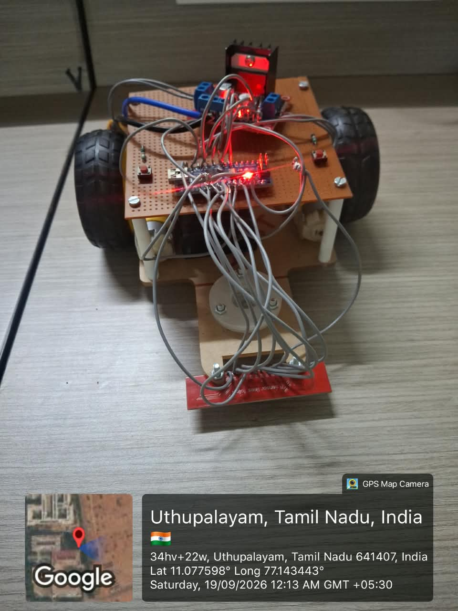

# Autonomous Line Following Robot Using PD Control

Arduino Nano-based line-following robot using an 8-channel QTR-8A analog sensor array, L298N motor driver and a Proportional-Derivative (PD) control algorithm. The robot follows a black line and uses direction-memory-based corner recovery.

## Hardware
- Arduino Nano
- QTR-8A 8-channel analog sensor array
- L298N dual H-bridge motor driver
- Two DC gear motors
- Action button (D9)
- Sensor-power control output (D10)

## Pin Connections

| Function | Arduino pin |
|---|---|
| L298N ENA | D5 |
| L298N IN1, IN2 | D3, D4 |
| L298N IN3, IN4 | D7, D8 |
| L298N ENB | D6 |
| Action button | D9 |
| Sensor-power control output | D10 |
| QTR-8A outputs | A0–A7 |

Verify the actual wiring and power arrangement before use.

## PD Algorithm
`error = position - targetPosition`

`derivative = error - previousError`

`correction = Kp * error + Kd * derivative`

The correction is added to one motor command and subtracted from the other. There is no integral term; this is PD, not PID.

## Supplied Tuning Parameters

| Parameter | Value |
|---|---:|
| Kp | 0.095 |
| Kd | 1.35 |
| Target position | 3500 |
| Position range | 0–7000 |
| Base speed | 130 |
| Maximum speed | 180 |
| Calibration iterations | 200 |
| Calibration delay | 20 ms |
| Active sensor threshold | 350 |

## Operating Sequence
1. Power the robot.
2. D10 is held HIGH by the sketch for the sensor-power arrangement used in the build.
3. Short press D9 to calibrate while stopped.
4. Long press D9 (at least 1 second) to toggle running/stopped.
5. During operation, the robot reads the black-line position and applies PD correction.
6. If the line is lost or detected near an edge, the robot attempts recovery using its last known direction.

## Software Setup
1. Install the QTRSensors library by Pololu.
2. Select Arduino Nano and the correct processor/bootloader option.
3. Open `Code/Line_Follower_PD.ino`.
4. Verify pin mapping, motor polarity and sensor wiring.
5. Upload and calibrate on the actual track.

## Repository Structure
- `Code/`: Arduino source
- `Documentation/`: PD explanation and library information
- `Hardware/`: pin connections
- `Results/`: test and competition record
- `Images/`: add actual robot photographs and videos

## Results and Achievement
Team DELTAONE secured 3rd Prize at IGNITRRON'26 Line Follower Hackathon. Add actual competition photographs, certificate and measured test results to this repository.

## Project Gallery

### 1. Robot Hardware

### 2. Robot in Action

### 3. Competition Achievement

## Author
Yeshwanth V
